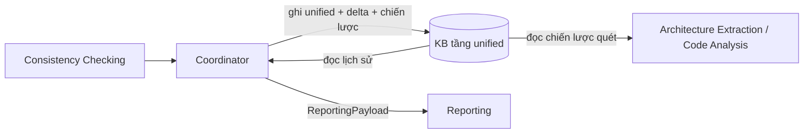

# Mô hình kiến trúc của Coordinator Agent

| File | Nội dung |
| --- | --- |
| `coordinator_architecture.json` | **Mô hình gốc**, theo đúng định dạng `ArchitectureGraph` của Architecture Extraction Agent (`nodes`, `edges`, `c4_level`, `relationship_type`...). 7 thành phần bên ngoài (cấp container) + 13 thành phần bên trong Coordinator (cấp component), 25 quan hệ. |
| `coordinator_component.puml` | Sơ đồ C4-PlantUML sinh từ JSON. Cùng cú pháp `Container(...)`, `Component(...)`, `Rel(...)` mà parser PlantUML của Architecture Extraction đọc được. |
| `coordinator_component.mmd` | Sơ đồ Mermaid sinh từ JSON, xem trực tiếp trên GitHub. |
| `coordinator_component.png` | Ảnh xuất từ Mermaid. |
| `build_diagrams.py` | Sinh lại `.puml` và `.mmd` sau khi sửa JSON. |

Mỗi thành phần bên trong ghi rõ file code (`module`) và nhiệm vụ số mấy trong 10 nhiệm vụ (`task`).

## Sửa mô hình

1. Sửa `coordinator_architecture.json`.
2. Chạy `python docs/architecture/build_diagrams.py`.
3. (Tùy chọn) Xuất ảnh: `mmdc -i docs/architecture/coordinator_component.mmd -o docs/architecture/coordinator_component.png`.

Xem file `.puml`: dán vào https://www.plantuml.com/plantuml hoặc cài extension PlantUML trong VS Code (cần mạng để tải thư viện C4).

