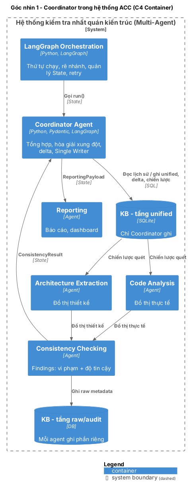
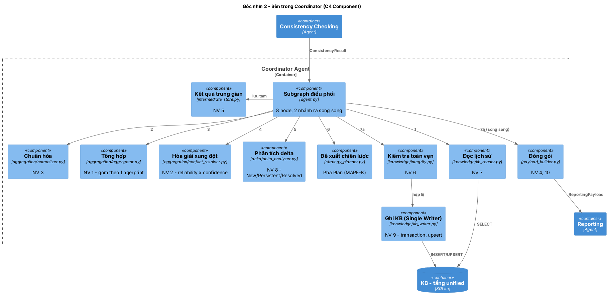
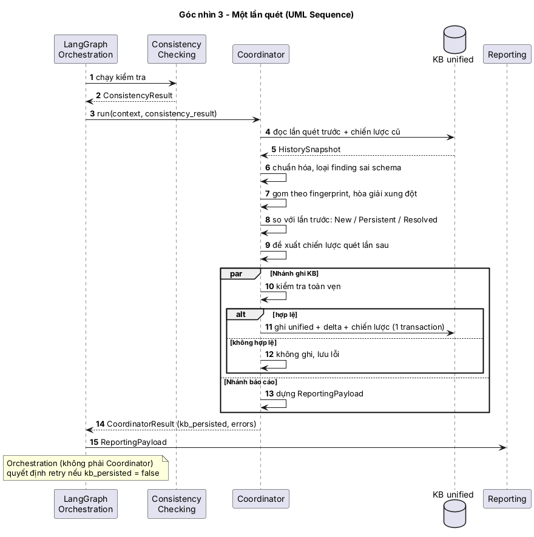
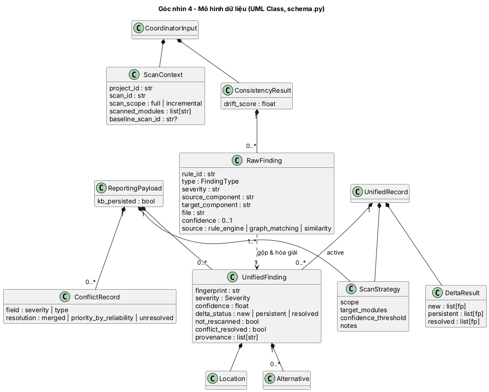
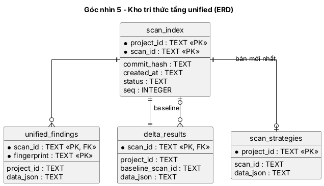
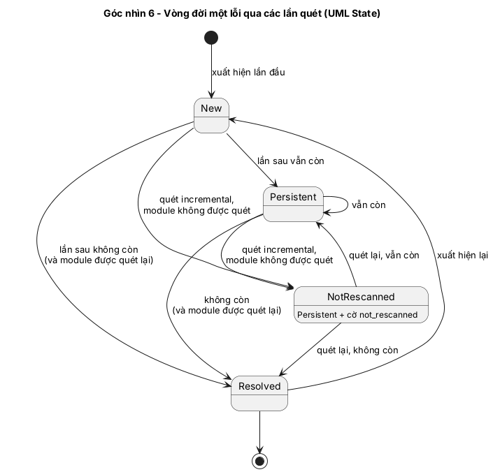
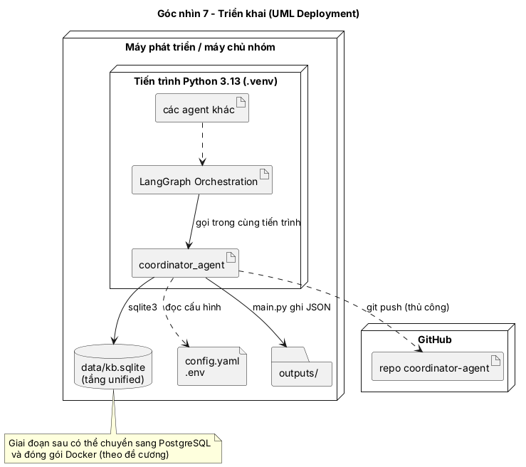

# Mô hình kiến trúc phần mềm của Coordinator Agent

Mô hình trình bày theo **4+1 góc nhìn** (Kruchten): logic, tiến trình, phát triển, vật lý và kịch bản. Sơ đồ viết bằng **PlantUML** (UML và C4). Các quyết định thiết kế quan trọng ghi lại dưới dạng **ADR** (Architecture Decision Record).

| Góc nhìn 4+1 | Sơ đồ | File nguồn |
| --- | --- | --- |
| Bối cảnh hệ thống | Coordinator trong hệ thống ACC (C4 Container) | `01_container.puml` |
| Phát triển | Các thành phần bên trong Coordinator (C4 Component) | `02_component.puml` |
| Tiến trình | Một lần quét, có 2 nhánh song song (UML Sequence) | `03_sequence.puml` |
| Logic | Mô hình dữ liệu `schema.py` (UML Class) | `04_class.puml` |
| Logic | Kho tri thức tầng unified (ERD) | `05_kb_erd.puml` |
| Kịch bản | Vòng đời một lỗi qua các lần quét (UML State) | `06_finding_state.puml` |
| Vật lý | Triển khai (UML Deployment) | `07_deployment.puml` |

Ảnh đã xuất nằm trong `img/`.

## 1. Coordinator trong hệ thống

## 2. Bên trong Coordinator

Số trên mũi tên là thứ tự chạy; "NV" là nhiệm vụ trong 10 nhiệm vụ của Coordinator.

## 3. Một lần quét

## 4. Mô hình dữ liệu

## 5. Kho tri thức tầng unified

## 6. Vòng đời một lỗi

## 7. Triển khai

## Quyết định kiến trúc (ADR)

| Mã | Quyết định |
| --- | --- |
| [ADR-001](adr/ADR-001-single-writer.md) | Coordinator là agent duy nhất ghi tầng unified |
| [ADR-002](adr/ADR-002-deterministic-conflict-resolution.md) | Hòa giải xung đột bằng công thức tất định, không dùng LLM |
| [ADR-003](adr/ADR-003-fingerprint.md) | Fingerprint không chứa số dòng |
| [ADR-004](adr/ADR-004-not-rescanned.md) | Quét incremental không được kết luận lỗi đã sửa |

Mỗi ADR đều được kiểm chứng bằng ít nhất một kịch bản trong `benchmark/`.

## Sửa sơ đồ

Mở file `.puml` trong VS Code với extension **PlantUML** (jebbs.plantuml) để xem trực tiếp, hoặc dán nội dung vào https://www.plantuml.com/plantuml. Thư viện C4 có sẵn trong PlantUML (`!include <C4/...>`), không cần tải thêm.
